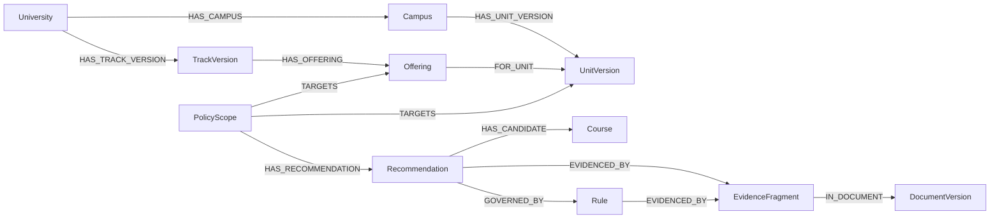

# 2027·2028 대입 전략 상담 에이전트 설계 초안

작성일: 2026-10-18
상태: 사용자 검토용. DB 생성·연결·적재 및 상담 서비스 구현 전 단계.

## 1. 확정한 범위

- 학생·학부모와 교사·상담사 모두 사용한다.
- 성적·이수과목은 화면 직접 입력 또는 정해진 엑셀·CSV로 입력한다. 첫 버전에서 학생부 전체 및 이미지 OCR 업로드는 제외한다.
- 가명 학생 프로필과 상담 기록을 로컬에 저장하고 수정·삭제를 지원한다.
- 대학·전형 안내를 넘어 지원요건 확인, 후보 비교, 과목·수능·면접 준비 전략과 지원 조합을 상담한다.
- 첫 버전의 상담 추천 범위는 6개 대학의 학생부교과·학생부종합 수시 전형이다. 논술·실기·특기자·정시는 기존 자료를 보존하되 자동 후보 추천에서 제외한다.
- 학생부교과는 반영교과·성적 산출·학교장추천·수능최저를, 학생부종합은 과목 이수·평가관점·면접 준비를 중심으로 분석한다. 자료가 없는 항목은 확인 불가로 표시한다.
- 로컬 LLM을 사용하며 외부 API에 학생 정보나 원문을 전송하지 않는다. 모델과 벡터 DB 제품은 구현 전에 결정한다.
- GraphDB는 로컬 Neo4j의 `ys_team_2026` 인스턴스, `admissions2028` 데이터베이스를 사용한다.
- Neo4j 연결 주소·인증·기존 데이터 상태는 아직 확인하지 않았다. 인스턴스 이름을 접속 URI로 간주하지 않는다.
- `course-guide`는 파일럿이며 읽기·재사용·수정 대상에서 제외한다.

## 2. 현재 자료와 재사용 경계

| 자료 | 활용 | 현재 확인된 제약 |
|---|---|---|
| `1_business_source_data`의 학생부전형 가이드 | 평가항목·평가관점·전형 특징·준비 안내·사례 | 건국대 가이드 파일명이 2026이다. 본문 적용 학년도 확인 전 2027 기준으로 취급하지 않는다. |
| 같은 폴더의 2028 시행계획·전공과목 가이드 | 모집단위·인원·요건·전형요소·권장과목 | 시행계획과 최종 모집요강을 구분한다. 미발표 일정은 임의 생성하지 않는다. |
| `2_2026_수시전형_입시결과` | 원본표·기준정보·지표·SQLite 재사용 | 데이터사전상 5개 대학이며 서울대 입결은 없다. |

기존 [스키마 요청서](data_schema.md)의 정규화 요구를 따른다. 입결의 기준은 [데이터사전](../2_2026_수시전형_입시결과/6_데이터사전/6_데이터사전.md)이다.

데이터사전상 기존 입결은 대학 5개, 전형 48개, 모집단위 524개, 원본행 1,668개, 지표 13,892개다. 이는 문서에 기재된 수치이며 이번 설계 단계에서 DB 실측한 값은 아니다. 2025 비교값과 2027 계획 인원도 섞여 있으므로 디렉터리 이름으로 모든 행의 학년도를 지정하지 않는다.

기존 `dim_university`, `dim_admission`, `dim_unit`, `fact_record`, `fact_metric` 및 조회 뷰를 읽기 전용으로 활용한다. 기존 CSV·스크립트·DB를 덮어쓰거나 새 ID로 치환하지 않고 연결용 매핑을 추가한다.

## 3. 기본 데이터 원칙

1. `admission_year`(지원 학년도), `curriculum_code`(교육과정), `grade_system_code`(등급체계), `publication_date`(문서 발행일)를 구분한다. 지원 학년도만으로 학생의 교육과정이나 등급체계를 강제하지 않는다.
2. 학년도별 전형과 모집단위를 별도 버전으로 저장한다. 전형명·학과명만으로 동일성을 확정하지 않는다.
3. 일반선택·진로선택·융합선택과 핵심권장·권장·지원자격 필수를 서로 다른 축으로 관리한다.
4. 미기재, 미발표, 비공개, 해당 없음, 검토 필요를 구분한다. 빈 값이나 `-`를 0으로 바꾸지 않는다.
5. 원문 사실, 시스템의 해석, 학생의 자기 입력, 검토자의 확인을 구분한다. 추출 신뢰도와 사람의 검토 상태는 별도 필드다.
6. 사실·조건·개편 관계마다 문서 버전과 페이지 근거를 연결한다. 상충하는 문서는 보존하고 자동으로 하나를 정답으로 선택하지 않는다.
7. 동일 근거가 단과대학·계열 전체에 적용되면 그 범위로 저장한다. 이를 개별 학과 발표인 것처럼 확장하지 않는다.
8. 이 초안의 테이블과 필드는 논리 설계다. 사용자 확인 뒤 데이터 타입·FK·CHECK·마이그레이션을 포함한 실행 DDL로 확정한다.

## 4. 대학 입학정보 관계형 스키마

### 4.1 근거와 기준정보

| 테이블 | 주요 필드 | 역할 |
|---|---|---|
| `source_document` | document_id, university_id, document_type, title, publication_date | 문서의 논리적 식별자 |
| `source_document_version` | document_version_id, document_id, file_sha256, local_path, revision_label, extraction_method, review_status | 파일별 불변 버전과 추출·검토 상태 |
| `source_fragment` | fragment_id, document_version_id, pdf_page, printed_page, table_key, row_key, bbox, quote | 페이지·표·문단 단위 원문 근거 |
| `evidence_set` / `evidence_set_item` | evidence_set_id / evidence_set_id, fragment_id | 하나의 사실에 연결되는 복수 근거 |
| `data_release` | release_id, created_at, approval_status | 상담에서 참조한 검토 완료 데이터 스냅샷 |
| `university` / `campus` | university_id, name / campus_id, university_id, name | 캠퍼스 혼동 방지 |
| `curriculum` / `grade_system` | curriculum_code, name / grade_system_code, kind, min_value, max_value | 2015·2022 교육과정과 9등급·5등급·성취도 체계 |
| `course` | course_id, curriculum_code, subject_group, official_name, elective_type | 교육과정별 과목. 같은 이름도 교육과정이 다르면 구분 |
| `course_alias` | alias_id, course_id, alias_text, review_status | 표기 차이와 입력 이름 해석 |

`source_document_version.file_sha256`으로 원본 중복을 검사한다. 한글 파일명 검색에는 NFC 정규화를 사용하되 실제 파일 경로를 보존한다. 원문에 PDF 쪽과 책자 쪽이 다르면 둘 다 기록한다.

### 4.2 학년도별 모집단위와 전형

| 테이블 | 주요 필드 | 역할 |
|---|---|---|
| `academic_unit` | unit_id, university_id, campus_id, unit_kind | 단과대학·학부·학과·전공의 안정적 식별자 |
| `academic_unit_version` | unit_version_id, unit_id, admission_year, official_name, field_name, field_basis, evidence_set_id | 학년도별 명칭·계열·근거 |
| `unit_membership` | parent_unit_version_id, child_unit_version_id, evidence_set_id | 해당 학년도의 단과대학·학부·전공 소속 |
| `admission_track` | track_id, university_id | 전형의 안정적 식별자 |
| `admission_track_version` | track_version_id, track_id, admission_year, official_name, admission_type, selection_type, round, evidence_set_id | 학년도별 전형 |
| `admission_offering` | offering_id, track_version_id, unit_version_id, quota_category, evidence_set_id | 전형과 모집단위의 실제 모집 조합 |
| `quota_fact` | quota_id, offering_id, quota_kind, count, value_status, release_id, evidence_set_id | 계획·수정계획·실제 결과를 구분한 모집인원 |
| `selection_stage` | stage_id, offering_id, stage_order, pass_count_rule_id, evidence_set_id | 단계별 선발과 배수·인원 조건 |
| `evaluation_component` | component_id, stage_id, component_type, weight, max_score, score_rule_id, evidence_set_id | 교과·서류·면접·수능·실기 등 전형요소 |
| `admission_event` | event_id, offering_id, event_type, start_at, end_at, timezone, value_status, evidence_set_id | 원서·서류·고사·발표·등록 일정 |

이름이 같은 연도 버전도 평가방법은 달라질 수 있다. 통합·분리로 별개 모집단위가 생긴 경우 같은 안정 ID에 억지로 넣지 않고 7절의 변경 매핑을 사용한다. 공통 평가·일정은 범위 테이블과의 연결로 재사용하며 학과별로 복제해 각각 수정하지 않는다.

### 4.3 범위·요건·권장과목·평가관점

| 테이블 | 주요 필드 | 역할 |
|---|---|---|
| `policy_scope` | scope_id, university_id, admission_year, scope_kind, scope_text, evidence_set_id | 대학 전체·계열·단과대학·전형·모집단위·모집조합 적용 범위 |
| `scope_unit` / `scope_track` / `scope_offering` | scope_id와 대상 버전 ID | 적용 대상 연결. 자유전공·예외 범위 보존 |
| `policy_rule` | rule_id, rule_version, rule_kind, rule_text, evidence_set_id, review_status | 지원자격·수능최저·반영점수·중복지원 등의 규칙 원문 |
| `rule_scope` | rule_id, scope_id, application_kind, supersedes_rule_id | 적용·예외·명시된 대체 관계 |
| `rule_expression` | expression_id, rule_id, parent_expression_id, node_kind, operator, threshold, fact_key, value_type | AND·OR·N개 선택·등급합 등 조건식 트리 |
| `rule_course_operand` | expression_id, course_id | 과목 집합의 구성원 |
| `rule_subject_operand` | expression_id, exam_subject_code, selection_rule | 수능 영역·탐구 선택·평균·절사 조건 |
| `course_recommendation` | recommendation_id, scope_id, curriculum_code, recommendation_level, rule_id, evidence_set_id | 핵심권장·권장·우선이수와 조건 |
| `recommendation_course` | recommendation_id, course_id, role | 과목별 후보·반드시 포함 등의 역할 |
| `evaluation_item` | item_id, parent_item_id, name | 평가역량·평가항목 계층 |
| `evaluation_guidance` | guidance_id, scope_id, item_id, perspective_text, emphasis, evidence_set_id | 전형별 평가중심·평가관점 |
| `admission_characteristic` | characteristic_id, scope_id, topic, description, evidence_set_id | 전형 특징·유의사항·학교 교육여건 고려 |
| `duplicate_application_rule` | rule_id, first_scope_id, second_scope_id, relation_kind | 동일 전형 내·전형 간·대학 간 중복지원 조건 |

`scope_kind`가 지시하는 대상 종류와 연결 테이블이 일치해야 한다. 계열 키워드 추정만으로 규칙 적용 범위를 확정하지 않는다. 구조화되지 않은 서술형 원문은 저장하되 규칙 엔진이 판정하지 않고 검토 필요를 반환한다.

조건 예시: 'A·B·C·D 중 3과목, A 포함'은 `AND(AT_LEAST(3, A,B,C,D), COMPLETED(A))`로 표현한다. 네 과목 모두 필수인 관계 네 개로 평탄화하지 않는다. 이는 구조 설명용 예시이며 특정 대학의 실제 요건이 아니다.

지원자격 필수와 권장과목 이수도는 별도 결과를 반환한다. 규칙 원문과 실행식이 일치하는지 검토 완료된 규칙만 자동 판정에 사용한다.

## 5. 기존 입시결과 연결

| 추가 연결 테이블 | 주요 필드 | 역할 |
|---|---|---|
| `external_dataset` | dataset_id, source_path, file_sha256, dictionary_version | 기존 DB의 버전 추적 |
| `external_university_map` | dataset_id, external_univ_id, university_id, review_status | 기존 대학 ID 유지 |
| `external_track_map` | dataset_id, external_adm_id, metric_year, track_version_id, mapping_kind, evidence_set_id, review_status | 연도별 전형 매핑 |
| `external_unit_map` | dataset_id, external_unit_id, metric_year, unit_version_id, mapping_kind, evidence_set_id, review_status | 연도별 모집단위 매핑 |
| `result_aggregation_scope` | aggregation_scope_id, dataset_id, external_record_id, metric_year, scope_level, shared_group_key, evidence_set_id | 모집단위·단과대학·캠퍼스·전형 전체 집계 구분 |

입결은 원래의 지표, 집계대상, 산출기준, 단위, 원문값과 출처를 보존해 조회한다. 조회 어댑터에서 원본 지표의 복합키·중복 여부를 실측한 뒤 영속 지표 ID를 정한다. `record_id`만으로 하나의 성적 지표를 식별하지 않는다.

중앙대 통합 병합셀의 같은 수치를 학과별로 반복 합산하지 않는다. 경희대 컷과 합격자 평균, 중앙대 지원자 평균·합격자 평균·등록자 컷을 서로 다른 지표로 다룬다. 미공개 값과 원문에서 둘로 나뉜 값을 임의로 하나의 수치로 채우지 않는다.

## 6. 학생 프로필 스키마와 개인정보 분리

학생 DB는 대학 공용 데이터 DB 및 벡터 인덱스와 분리한다. 첫 버전은 로컬 사용이며 인증 없는 상태로 외부 네트워크에 공개하지 않는다. 학생용·상담사용 화면의 구분은 사용자 인증이나 접근 통제를 대신하지 않는다.

| 테이블 | 주요 필드 | 역할 |
|---|---|---|
| `student_profile` | student_id, nickname, target_admission_year, curriculum_code, school_type, current_grade, graduation_status, created_at | 가명 프로필. 실명·주민번호·연락처는 수집하지 않음 |
| `profile_revision` | profile_revision_id, student_id, revision_no, confirmed_at | 상담 기준 학생 정보 버전 |
| `student_term` | term_id, profile_revision_id, school_year, grade_level, semester | 학교 학년과 달력 연도 분리 |
| `student_course_record` | record_id, term_id, course_id, original_course_name, completion_status, credits, rank_grade, rank_grade_system, achievement, achievement_system, raw_score, subject_mean, subject_stddev, cohort_size | 과목별 성적·성취도·학점. 미제공 값 허용 |
| `student_course_availability` | availability_id, profile_revision_id, course_id, availability_status, alternative_plan | 학교 미개설·공동교육과정 등 과목 선택 여건 |
| `student_exam` / `student_exam_score` | exam_id, profile_revision_id, exam_kind, exam_date / exam_id, subject, grade, standard_score, percentile | 모의고사와 실제 수능 구분 |
| `student_preference` | preference_id, profile_revision_id, preference_kind, target_key, priority | 희망 전공·대학·지역·전형 및 제약 |
| `student_eligibility_fact` | fact_id, profile_revision_id, fact_key, typed_value, verification_status, checked_at | 요건 판단에 필요한 최소 사실. 미입력과 false를 구분 |
| `student_import_batch` / `student_import_issue` | batch_id, student_id, file_hash, status / batch_id, row_no, field_name, issue_code | 업로드 미리보기·검증·확정. 중복 입력 방지 |
| `counseling_session` | session_id, student_id, profile_revision_id, release_id, model_id, started_at | 상담 재현 기준 |
| `counseling_message` | message_id, session_id, role, redacted_content | 비식별화한 질문·답변 |
| `candidate_assessment` | assessment_id, session_id, offering_id, eligibility_status, course_readiness, comparison_status, rationale | 후보별 분석. 합격 확률 필드는 만들지 않음 |
| `assessment_evidence` / `assessment_action` | assessment_id, evidence_set_id / assessment_id, action_type, description, due_status | 추천 근거·추가 확인·준비 과제 |

학생 입력 템플릿의 기본 열: 학년, 학기, 과목명, 교육과정, 선택유형, 이수상태, 학점, 석차등급, 등급체계, 성취도. 성취도만 제공되는 과목은 석차등급을 요구하지 않는다. 이수예정 과목에는 성적이 없어도 된다. 실제 파일 헤더는 예시 데이터로 검증 후 확정한다.

가명도 과목·성적·상담내용과 결합하면 개인정보가 될 수 있다. 지원자격 관련 민감한 사유는 필요한 경우에만 선택 입력받고, 증빙 원본 대신 확인 여부와 최소 사실을 우선한다. 원본 업로드는 검증·확정 후 삭제하는 방안을 제안한다.

2026-10-18 사용자 확인으로 저장 경계를 확정했다. 학생 프로필·성적·선호·지원자격 사실·상담내용은 별도 로컬 학생 DB에만 영속 저장한다. Neo4j와 공용 벡터 DB에는 대학 공용 정보만 적재하며 가명 학생 노드·학생-과목 관계·학생별 평가 결과도 저장하지 않는다. 상담 중 필요한 학생-과목 비교는 요청 메모리에서 수행하고 종료 후 폐기하며, 공용 검색 인덱스나 로그에 복제하지 않는다. 영속 학생 그래프는 현재 구현 범위에서 제외한다.

프로필 삭제는 학생 DB의 성적·업로드·상담·캐시를 함께 삭제한다. 파일·검색 인덱스·백업에도 데이터가 남는지 검사한다. 보관 기한과 백업 정책은 사용자 확인 사항이며, 백업까지 즉시 삭제한다고 검증 없이 약속하지 않는다.

## 7. Neo4j 스키마

연결 설정 계약: `NEO4J_URI`는 실제 주소 확인 후 지정, `NEO4J_DATABASE=admissions2028`. 인스턴스는 `ys_team_2026`을 사용한다. 비밀번호는 대화·문서·소스·로그에 기록하지 않고 로컬 비밀 설정으로 주입한다.

대학 관련 그래프는 관계형 데이터의 파생 조회 모델이다. 양쪽에 별도 수작업 수정 경로를 만들지 않는다. 모든 소유 노드는 공통 `Admissions2028` 라벨, `admissions_id`, `release_id`를 가지며 추가 타입 라벨로 구분한다. 기존 그래프의 동명 라벨·속성·제약조건과 충돌하는지 읽기 전용 점검 후 확정한다.

| 노드 타입 | 기준 ID |
|---|---|
| University, Campus | 대학·캠퍼스 ID |
| UnitVersion, TrackVersion, Offering | 학년도별 모집단위·전형·모집조합 ID |
| Course, Curriculum | 교육과정별 과목 ID·교육과정 코드 |
| PolicyScope, Rule, Recommendation | 범위·규칙·권장과목 그룹 ID |
| EvaluationItem, EvaluationGuidance | 평가항목·전형별 평가관점 ID |
| DocumentVersion, EvidenceFragment | 문서 버전·근거 조각 ID |
| ChangeMapping | 변경 관계 자체의 ID |
| HistoricalResultRef | 외부 데이터셋·원본행·학년도·집계범위 참조 ID |

주요 관계:

`HAS_CANDIDATE`는 후보 관계이며 필수 이수 관계가 아니다. 복합 조건의 실제 판정은 같은 규칙 버전을 사용하는 규칙 검증 도구가 담당한다. 학생별 과목 추천 시 대학 정책 범위와 모집단위 소속을 함께 확인한다.

학년도 변경은 `ChangeMapping` 노드로 표현한다. 주요 필드는 entity_kind, change_kind, from_year, to_year, review_status, comparability_status, rationale, evidence_set_id다. `FROM_VERSION`과 `TO_VERSION`에 여러 노드를 연결하여 통합·분리·명칭 변경을 표현한다. 학과와 전형 변경 매핑을 섞지 않는다.

단순 명칭 유사도는 검토 대상을 제시하는 데만 사용한다. 검토되지 않은 매핑으로 과거 입결을 현재 학과의 직접 실적으로 붙이지 않는다. 조직상 계승이 확인되어도 입결 비교 가능성은 별도로 판정한다.

적재는 안정 ID 기반 `MERGE`와 건수·고아 노드·근거 누락 검사를 사용한다. `MATCH` 실패 후 0건 적재를 성공으로 처리하지 않는다. 전체 `DETACH DELETE`, 기존 데이터 초기화, 타 데이터베이스 변경은 하지 않는다. 폐기 데이터도 먼저 스냅샷·소유권을 확인하고 해당 릴리스 범위에서만 처리한다.

## 8. 벡터 검색과 에이전트 도구

문서 청크 메타데이터: chunk_id, document_version_id, fragment_id, university_id, admission_year, curriculum_code, document_type, revision_status, pdf_page, section_path, extraction_method, review_status, release_id.

학년도·대학·문서 상태로 먼저 범위를 제한하고 문단·표·각주의 의미를 보존해 청킹한다. 표의 여러 열과 '중 N과목' 조건이 분리되지 않도록 한다. 공용 청크에 학생 입력이나 상담 기록은 포함하지 않는다. 임베딩 모델을 바꾸면 새 인덱스를 생성하고 검증 후 전환한다.

| 도구 | 입력과 출력 | 제약 |
|---|---|---|
| `read_student_profile` | 학생 ID·버전 -> 입력·누락 항목 | 현재 상담 대상만 접근 |
| `lookup_admission_facts` | 학년도·대학·전형·모집단위 -> 정형 사실 | 읽기 전용·검토된 릴리스 |
| `traverse_admission_graph` | 개체·학년도·관계 유형 -> 근거 있는 관계 경로 | 대상 DB 고정·탐색 깊이 제한 |
| `retrieve_document_evidence` | 질문·학년도·문서 범위 -> 원문 근거 | 미검토·이전 교육과정 혼입 방지 |
| `evaluate_policy_rules` | 규칙 버전·학생 사실 -> 충족/미충족/정보 부족 | LLM이 아닌 검증된 계산 |
| `compare_historical_results` | 학생·대상 모집조합·지표 -> 비교 결과 또는 차단 사유 | 비교 가능성 검사 필수 |
| `check_application_portfolio` | 후보 모집조합 -> 중복·일정·횟수 충돌 | 규정·일정 부족 시 확인 불가 |

사용자는 검색 엔진을 고를 필요 없이 상담한다. 에이전트가 필요한 도구를 조합하고 상담사 화면에서 검색 경로·SQL·근거·규칙 판정을 확인한다. Text-to-SQL을 제공하더라도 읽기 전용 허용 뷰와 파라미터 범위만 조회하며, LLM이 생성한 SQL·Cypher를 무제한 실행하지 않는다.

후보 조회 도구의 기본 범위는 `round = 수시`이고 `admission_type IN (학생부교과, 학생부종합)`인 검토 완료 모집조합이다. UI 필터뿐 아니라 도구의 조회 경계에서도 같은 범위를 적용한다. 범위 밖 질문은 지원 범위를 알리고, 논술 데이터를 삭제하거나 학생부 전형으로 재분류하지 않는다.

처리 순서: 상담 대상·학년도 확인 -> 정보 부족 질문 -> 후보 조회 -> 지원요건 검사 -> 과목 준비도 및 평가관점 비교 -> 입결 비교 가능성 검사 -> 지원 조합 점검 -> 근거 기반 답변.

## 9. 비교와 답변 정책

- 2027 현역과 2028 현역의 교육과정·등급체계 차이를 고려하되 졸업생 등 예외는 실제 학생 입력으로 판단한다.
- 2028 학생의 5등급과 2026 입결의 9등급을 선형 환산하거나 직접 비교하지 않는다.
- 같은 등급체계라도 지표·집계대상·산출기준·반영교과·집계범위·전형 및 모집단위 변경을 확인해야 한다. 연세대 반영교과처럼 근거가 없으면 직접 비교를 보류한다.
- 50%컷·70%컷·합격자 평균·지원자 평균은 별도 지표다. 공개 컷은 최저합격선이나 합격 확률이 아니다.
- 학생부종합전형에서 내신만으로 합격 가능성을 판정하지 않는다. 서류·활동 정보를 받지 않는 첫 버전의 판단 한계를 표시한다.
- 검증된 예측모형이 없는 첫 버전에서는 합격 확률과 확정적 안정/적정/상향 등급을 출력하지 않는다. 강점·준비 과제·위험요인 중심으로 후보를 비교한다.
- 모의고사는 수능최저 대비 시나리오이며 실제 충족 확정이 아니다. 미이수 권장과목은 지원 부적격과 다르다.
- 서울대 입결 없음, 일정 미발표, 규정 미확인, 과거 매핑 미검토를 각각 밝힌다. 확인 불가를 불충족으로 바꾸지 않는다.
- 사실 설명에는 문서·페이지, 정량 계산에는 적용 규칙·입력 기준, 전략에는 근거와 불확실성을 구분해 표시한다.

## 10. 단계별 실행과 통과 기준

| 단계 | 산출물 | 통과 기준 |
|---|---|---|
| A. 설계 확인 | 이 문서, 입력 항목·보관 범위 | 사용자 검토 완료 |
| B. 자료·연결 점검 | 문서 매니페스트, 실제 DB 스키마·건수, Neo4j 읽기 전용 연결 점검 | 적용 학년도·버전·원문 경로 확인, 기존 데이터 변경 없음 |
| C. 관계형 DB | 실행 DDL, 대학별 파서, 검토용 표 | FK·범위·모집인원·전형요소·조건·근거 검증 |
| D. 그래프·벡터 적재 | Neo4j 파생 그래프, 문서 벡터 인덱스 | 관계 개수 대조, 고아·누락·역연도 매핑 검사, 검색 회귀 통과 |
| E. 학생 입력·규칙 | 업로드 템플릿, 입력 검증, 규칙 판정 도구 | 예정과목·미기재·성취도·복합 조건·예외 테스트 통과 |
| F. 상담 화면 | 학생·상담사 화면, 후보별 설명·출처 | 실제 사례 평가, 정보 부족 질문, 차단 정책 및 삭제 검증 |

필수 회귀 사례: 5등급과 9등급 직접 비교 차단; 이수예정 과목 성적 미입력 허용; 성취도만 있는 과목 처리; AND/OR/중 N과목 조건; 추천과 필수의 구분; 통합·분리 학과 매핑; 중복 병합셀 집계 차단; 모의고사와 실제 수능 구분; 원문 없는 숫자 생성 차단; 학생 간 데이터 누출 및 삭제 잔존 검사.

## 11. 다음 확인 사항

1. 상담 범위는 학생부교과·학생부종합 수시 중심으로 확정했다(2026-10-18). 논술 등의 과거 데이터는 보존하며 첫 버전 자동 추천 대상에서는 제외한다.
2. 저장 경계는 확정했다(2026-10-18). Neo4j와 공용 벡터 DB에는 대학 공용 정보만 적재하고, 학생 성적·상담기록은 별도 로컬 학생 DB에만 영속 저장한다. 영속 학생 그래프는 만들지 않는다.
3. 프로필 보관 기한·업로드 원본 삭제·백업 정책, 실제 접속 주체와 로컬 접근 통제를 확인한다.
4. 실행 DDL과 입력 템플릿, 공용 문서 근거의 Neo4j 적재 결과는 [구현 안내](README.md)에 정리했다. [로컬 질의 에이전트](../counseling_agent/README.md)는 SQL·그래프 조회와 로컬 LLM 인용 답변을 제공한다. 학생 업로더·규칙 계산기·확정 추천은 아직 구현하지 않았다. Neo4j 인증정보는 채팅으로 받지 않는다.